# Examples Guide

These practical examples show useful Sensor Bar Card Plus combinations rather than every option. Replace the example entity IDs with your own entities and adjust the Scale to match their values. Both the standalone card and Card Feature use the sensor's unit by default; neither converts values between units. The [Configuration Reference](configuration.md) covers all options, defaults, and advanced behavior.

The standalone comparisons below follow the **Visual Examples** view in the [example dashboard](../examples/dashboards/sensor-bar-card-plus-screenshots.yaml). To try its live controls, load the [playground package](../examples/packages/sensor_bar_card_plus_playground_package.yaml) as well. The comparison sensor is `sensor.sbcp_examples_primary`, initially **7200 W** on a **0–10000 W** Scale. The fixed-Scale cards below also work with your own power sensor without those helpers.

Each YAML block is a complete card unless introduced as a replacement or an addition to an existing card.

## Card Feature

The same installed resource provides `custom:sensor-bar-card-plus-feature`. Add it to a Tile's `features` list, using the Visual Editor or YAML. These complete Tile examples use the shared [Configuration Reference](configuration.md#card-feature-configuration); `entities`, standalone Layouts, Hero and card titles do not belong inside a Feature.

### Minimal: inherit the Tile entity

With no Feature `entity`, SBCP inherits `sensor.battery_charge` from the Tile. The inherited entity is not written into Feature YAML. The default Scale is 0–100; choose explicit bounds when your sensor has a different range.

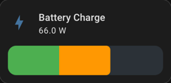

```yaml
type: tile
entity: sensor.battery_charge
features:
  - type: custom:sensor-bar-card-plus-feature
```

### Scale and Segments in Inline placement

This battery gauge uses a fixed 0–100 Scale and soft bands. Needle keeps all ranges visible while indicating the current charge.

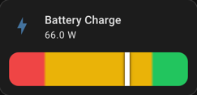

The screenshot shows Bottom placement; the YAML below uses Inline placement.

```yaml
type: tile
entity: sensor.battery_charge
features_position: inline
features:
  - type: custom:sensor-bar-card-plus-feature
    scale:
      min: { fixed: 0 }
      max: { fixed: 100 }
    bar:
      fill_style: soft_bands
      needle: true
      segments:
        - { from: 0%, to: 20%, color: "#ef4444" }
        - { from: 20%, to: 80%, color: "#eab308" }
        - { from: 80%, to: 100%, color: "#22c55e" }
```

`features_position` belongs to the Tile, not the SBCP Feature. Home Assistant supports `bottom` (default) and `inline`; Inline places the first feature beside the Tile's name. See the [Tile documentation](https://www.home-assistant.io/dashboards/tile/) for placement rules. Both placements support SBCP marker labels.

### Baseline and marker context

For import/export power, Baseline starts the fill at zero. Target marks an import limit, Peak and Floor show the maximum and minimum from their configured Recorder history windows, and a Reference Marker identifies an export threshold. Compact labels use the same text/value/unit configuration as the standalone card and adapt to available width.

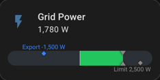

```yaml
type: tile
entity: sensor.grid_power
features:
  - type: custom:sensor-bar-card-plus-feature
    scale:
      min: { fixed: -3000 }
      max: { fixed: 3000 }
    baseline:
      at: { fixed: 0 }
      above: { color: "#22c55e" }
      below: { color: "#3b82f6" }
    target:
      at: { fixed: 2500 }
      label: { show: true, text: Limit, precision: 0 }
    peak: { enabled: true, window: today }
    floor: { enabled: true, window: today }
    markers:
      - at: -1500
        lane: above
        shape: diamond
        color: "#3b82f6"
        label: { show: true, text: Export, precision: 0 }
    formatting: { unit: W, decimal: 0 }
```

Peak/Floor use Home Assistant Recorder history and can recover their values after a dashboard reload when the selected history is available. Baseline takes precedence over a configured Needle while it resolves. See [Baseline](configuration.md#baseline), [Peak and Floor history windows](configuration.md#peak-and-floor-history-windows), [Reference Markers](configuration.md#generic-reference-markers) and [compact labels](configuration.md#compact-card-feature-marker-labels) for details.

### Compact Peak and Floor history example

Peak and Floor can use different windows. This example compares today's local calendar maximum with the minimum over a rolling seven days:

```yaml
type: custom:sensor-bar-card-plus
entity: sensor.grid_power
peak: { enabled: true, window: today }
floor: { enabled: true, window: 7d }
```

Recorder retention, supported statistics and known coverage limits determine whether each result is available. See [Recorder, statistics, and coverage](configuration.md#recorder-statistics-and-coverage) for the details and status indicators.

### Choose a different history window

Use `yesterday` for the previous local calendar day, or a rolling duration such as `24h` to look back from the current time:

```yaml
peak:
  enabled: true
  window: yesterday
floor:
  enabled: true
  window: 24h
```

Longer windows use Home Assistant long-term statistics for completed hours. For example, `7d` selects a rolling week and `previous_month` selects the previous local calendar month:

```yaml
peak:
  enabled: true
  window: 7d
floor:
  enabled: true
  window: previous_month
```

Long-term statistics must provide compatible min/max metadata. An entity attribute can be used with short windows backed by raw Recorder history:

```yaml
type: custom:sensor-bar-card-plus
entities:
  - entity: sensor.air_quality
    attribute: co2
    peak: { enabled: true, window: today }
    floor: { enabled: true, window: 24h }
```

Attributes do not have long-term statistics and therefore cannot supply windows longer than 24 hours. See [Recorder, statistics, and coverage](configuration.md#recorder-statistics-and-coverage) for details.

### History status indicators

On a visible Peak or Floor marker, `!` means partial history and `~` means a stale cached result; hover or keyboard-focus the marker for the reason, or tap it on touch screens. A row-level badge shows `…` when all unresolved enabled Peak/Floor results are pending, and `!` when any such result is unresolved; hover, focus, or tap the badge for its explanation. Normally available history has no indicator. A missing historical result is not replaced with the current sensor reading, and Recorder retention gaps are not always detectable. See [Recorder, statistics, and coverage](configuration.md#recorder-statistics-and-coverage).

### Explicit entity override: power beside a switch

The Tile represents a heat-pump switch, whose on/off state is nonnumeric. The Feature overrides its entity to visualize the related power sensor; the Tile retains its normal switch interaction and state.

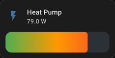

The screenshot illustrates the gradient Bar with a numeric Tile reading; the YAML below demonstrates a switch Tile with a separate numeric Feature entity.

```yaml
type: tile
entity: switch.heat_pump
features:
  - type: custom:sensor-bar-card-plus-feature
    entity: sensor.heat_pump_power
    scale:
      min: { fixed: 0 }
      max: { fixed: 100 }
    bar:
      fill_style: gradient
      gradient_stops:
        - { pos: 0, color: "#22c55e" }
        - { pos: 100, color: "#ef4444" }
```

The explicit override is saved inside the Feature. Remove it to return to parent-entity inheritance; this particular nonnumeric parent then produces a Feature status rather than a Bar. No extra JavaScript resource is needed. See the [README Card Feature guide](../README.md#card-feature).

## Label Layouts

| Layout | Use it when… | Tradeoff |
|---|---|---|
| Left | Several named metrics should line up beside their rails. | The label column consumes horizontal space; the reading may move above. |
| Above | Text should stay clear of the fill and references. | The name and reading header adds height. |
| Inside | Compact rows matter more than an unobstructed rail. | Name and reading pills cover some rail detail. |
| Off | A surrounding title already identifies the metric. | No name is displayed; the icon and reading can still provide context. |
| Hero | One prominent reading should be easy to scan. | Larger typography needs room and shrinks to fit. |

These label Layouts apply to the standalone card. **Hero does not display an entity icon.** This is intentional at every width. The other layouts can show an entity icon and may hide it responsively when space is constrained. Use `icon: false` on a row to remove it explicitly.

This comparison repeats the same sensor so only the layout changes. Leave rail height implicit to let responsive density adapt.

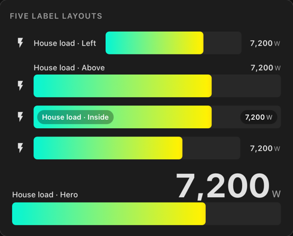

```yaml
type: custom:sensor-bar-card-plus
title: Five Label Layouts
layout:
  label: { position: left, width: 150 }
scale:
  min: { fixed: 0 }
  max: { fixed: 10000 }
formatting: { decimal: 0 }
bar:
  fill_style: gradient
  gradient_stops:
    - { pos: 0, color: "#00F5D4" }
    - { pos: 70, color: "#FFF200" }
    - { pos: 100, color: "#FF007F" }
entities:
  - entity: sensor.sbcp_examples_primary
    name: House load · Left
  - entity: sensor.sbcp_examples_primary
    name: House load · Above
    layout: { label: { position: above } }
  - entity: sensor.sbcp_examples_primary
    name: House load · Inside
    layout: { label: { position: inside } }
  - entity: sensor.sbcp_examples_primary
    layout: { label: { position: 'off' } }
  - entity: sensor.sbcp_examples_primary
    name: House load · Hero
    layout:
      label: { position: hero }
      hero: { size: small }
```

See [Layout Options and Responsive Behavior](configuration.md#layout-options-and-responsive-behavior) for fitting and sizing details.

## Fill styles

Needle paints the full rail and indicates the current value. This keeps every color region visible, even at a low reading, making the fill styles easier to compare.

The shared palette is cyan **#00F5D4**, yellow **#FFF200**, and magenta **#FF007F**. Gradient stops sit at **0%, 70%, and 100%**. Segment ranges are **0–40%, 40–80%, and 80–100%**.

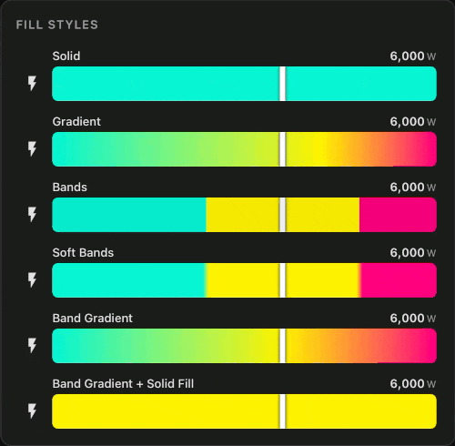

```yaml
type: custom:sensor-bar-card-plus
title: Fill Styles
layout: { label: { position: above } }
scale:
  min: { fixed: 0 }
  max: { fixed: 10000 }
formatting: { decimal: 0 }
bar:
  color: "#00F5D4"
  needle: { show: true, color: "#F8FAFC" }
  gradient_stops:
    - { pos: 0, color: "#00F5D4" }
    - { pos: 70, color: "#FFF200" }
    - { pos: 100, color: "#FF007F" }
  segments:
    - { from: 0%, to: 40%, color: "#00F5D4" }
    - { from: 40%, to: 80%, color: "#FFF200" }
    - { from: 80%, to: 100%, color: "#FF007F" }
entities:
  - entity: sensor.sbcp_examples_primary
    name: Solid
    bar: { fill_style: solid }
  - entity: sensor.sbcp_examples_primary
    name: Gradient
    bar: { fill_style: gradient }
  - entity: sensor.sbcp_examples_primary
    name: Bands
    bar: { fill_style: bands }
  - entity: sensor.sbcp_examples_primary
    name: Soft Bands
    bar: { fill_style: soft_bands }
  - entity: sensor.sbcp_examples_primary
    name: Band Gradient
    bar: { fill_style: band_gradient }
  - entity: sensor.sbcp_examples_primary
    name: Band Gradient + Solid Fill
    bar: { fill_style: band_gradient, solid_fill: true }
```

- **Solid** stays cyan regardless of the reading.
- **Gradient** blends between its percentage stops.
- **Bands** keeps hard boundaries between adjacent Segment colors and interpolates across gaps; the first and last colors extend to the rail edges.
- **Soft Bands** blends briefly around a Segment boundary where neighboring ranges have room; the transition width does not follow the authored gap.
- **Band Gradient** turns the Segment color sequence into a continuous gradient.
- **Band Gradient + Solid Fill** samples that gradient at the current value and paints the entire Needle rail with the sampled color. The color changes as the value moves; `solid_fill` is a modifier, not a sixth `fill_style` value.

At 7200 W the Needle sits at 72%. Remove `bar.needle` to use reveal fill from the selected Bar edge to the reading instead. See [Fill Styles Reference](configuration.md#fill-styles-reference) for exact color placement and modifiers.

## Scale and Segment coordinates

The cards above use a fixed **0–10000 W** Scale and percentage Segment boundaries. A plain Segment boundary is a **Scale value**: `2000` means 2000 W here. A `%` boundary is a **semantic position from Scale minimum to maximum**: `75%` means 7500 W on this Scale, and its physical position follows Scale Direction.

This comparison uses value thresholds at 2000/6000 W, then replaces the second threshold with 75%:

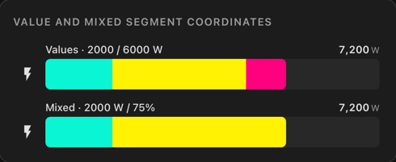

```yaml
type: custom:sensor-bar-card-plus
title: Value and Mixed Segment Coordinates
layout: { label: { position: above } }
scale:
  min: { fixed: 0 }
  max: { fixed: 10000 }
formatting: { decimal: 0 }
bar:
  fill_style: bands
  segments:
    - { from: 0%, to: 2000, color: "#00F5D4" }
    - { from: 2000, to: 6000, color: "#FFF200" }
    - { from: 6000, to: 100%, color: "#FF007F" }
entities:
  - entity: sensor.sbcp_examples_primary
    name: Values · 2000 / 6000 W
  - entity: sensor.sbcp_examples_primary
    name: Mixed · 2000 W / 75%
    bar:
      segments:
        - { from: 0%, to: 2000, color: "#00F5D4" }
        - { from: 2000, to: 75%, color: "#FFF200" }
        - { from: 75%, to: 100%, color: "#FF007F" }
```

Changing the maximum to 8000 moves the 2000/6000 W thresholds to 25%/75% of the Scale. The mixed row's 75% threshold stays at that semantic fraction and now means 6000 W. **Gradient stops differ:** bare `pos: 70` always means semantic 70%, never 70 W. Reversing Scale Direction projects these Paint coordinates to their opposite physical positions; keep the definitions in the same semantic order.

For live Scale controls, replace the card's `scale` block with the dashboard's paired sources and complete fixed fallback:

```yaml
scale:
  min:
    entity: input_number.sbcp_examples_scale_min
    fixed: 0
  max:
    entity: input_number.sbcp_examples_scale_max
    fixed: 10000
```

The bounds follow the helpers live. If either source is unavailable, this complete fallback supplies 0–10000 W. See [Scale and live sources](configuration.md#scale-and-dynamic-value-sources) and [Segment boundaries](configuration.md#segment-boundaries) for source and range rules.

## Scale and Bar Direction

Scale Direction controls where the values appear; Bar Direction independently chooses whether reveal fill runs from the left or right. For example, this row uses a reversed 0–100 Scale and fills from the physical right edge:

```yaml
type: custom:sensor-bar-card-plus
scale:
  min: { fixed: 0 }
  max: { fixed: 100 }
  direction: reverse
bar:
  direction: reverse
entities:
  - entity: sensor.battery_level
```

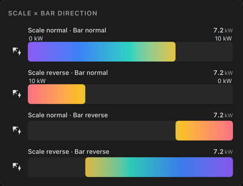

For a visual comparison of all four Scale/Bar combinations, plus reversed Scale markers, Needle and bipolar Baseline, open the **Direction Showcase v1.9** view in the [Screenshot dashboard](../examples/dashboards/sensor-bar-card-plus-screenshots.yaml).

## Use an entity attribute as a value

Use `entities[].attribute` to read a scalar attribute directly as a row's value. The attribute's unit is not inferred from the entity domain, so set it explicitly when needed:

```yaml
type: custom:sensor-bar-card-plus
scale:
  min: { fixed: 0 }
  max: { fixed: 40 }
formatting:
  unit: "°C"
  decimal: 1
entities:
  - entity: climate.living_room
    attribute: temperature
    name: Living room
```

Other dynamic sources use the documented `{ id, attribute }` form. For example, a Scale bound can read the same kind of scalar attribute while retaining a fixed fallback:

```yaml
scale:
  min: { fixed: 0 }
  max:
    entity: { id: climate.living_room, attribute: temperature }
    fixed: 40
```

See [Scale and live sources](configuration.md#scale-and-dynamic-value-sources) for source and fallback behavior.

## Compact Needle

This Gradient gauge uses an explicit **24 px rail**. The header makes the complete row taller than 24 px. Needle keeps the full colored rail painted and marks the reading instead of revealing a growing fill.

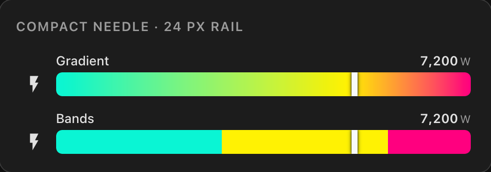

```yaml
type: custom:sensor-bar-card-plus
title: Compact Power Gauge
layout:
  height: 24
  label: { position: above }
scale:
  min: { fixed: 0 }
  max: { fixed: 10000 }
formatting: { decimal: 0 }
bar:
  fill_style: gradient
  needle: { show: true, color: "#F8FAFC" }
  gradient_stops:
    - { pos: 0, color: "#00F5D4" }
    - { pos: 70, color: "#FFF200" }
    - { pos: 100, color: "#FF007F" }
entities:
  - entity: sensor.sbcp_examples_primary
    name: Power
```

Needle works with every fill style and `solid_fill`. An active, resolved Baseline suppresses it. See [Needle](configuration.md#needle).

## Baseline origins and side colors

By default, reveal fill starts at the physical edge selected by Bar Direction. With Baseline, fill spans **Baseline to the current value**, extending in either direction. Scale Direction projects Baseline and the value onto the rail; a persistent line marks Baseline even when the reading equals it.

Compare a fixed 0 W origin, the visible midpoint, and a live origin with blue below/green above. On this Scale, 50% is 5000 W; if the minimum becomes −2000 W, the midpoint becomes 4000 W while the fixed origin remains 0 W.

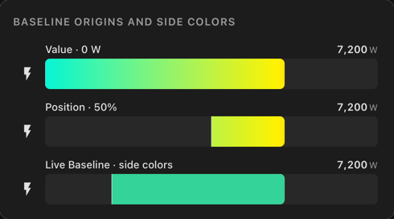

```yaml
type: custom:sensor-bar-card-plus
title: Baseline Origins and Side Colors
layout: { label: { position: above } }
scale:
  min: { fixed: 0 }
  max: { fixed: 10000 }
formatting: { decimal: 0 }
bar:
  fill_style: gradient
  gradient_stops:
    - { pos: 0, color: "#00F5D4" }
    - { pos: 70, color: "#FFF200" }
    - { pos: 100, color: "#FF007F" }
entities:
  - entity: sensor.sbcp_examples_primary
    name: Value · 0 W
    baseline: { at: { fixed: 0 } }
  - entity: sensor.sbcp_examples_primary
    name: Position · 50%
    baseline: { at: 50% }
  - entity: sensor.sbcp_examples_primary
    name: Live Baseline · side colors
    baseline:
      at: { entity: input_number.sbcp_examples_baseline, fixed: 2000 }
      below: { color: "#60A5FA" }
      above: { color: "#34D399" }
```

Move the reading below, equal to, and above the live Baseline to see the direction change. These cards use reveal fill; adding Needle would not show it while Baseline resolves. See [Baseline](configuration.md#baseline) for further combinations.

## Target, Peak and Floor

Add these settings to a power card with the 0–10000 W Scale, or to one of its entity rows. The live Target has a fixed 6500 W fallback. Its default Diamond sits below the rail; Peak is an above-lane triangle and Floor is a below-lane triangle.

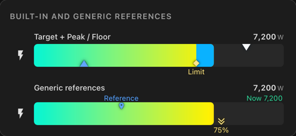

```yaml
target:
  at: { entity: input_number.sbcp_examples_target, fixed: 6500 }
  color: "#FDE68A"
  label:
    show: true
    text: Limit
    show_value: false
    show_unit: false
  when_exceeded:
    fill_color: "#00B2FF"
peak:
  enabled: true
  color: "#F8FAFC"
floor:
  enabled: true
  color: "#60A5FA"
```

The revealed portion above Target becomes vivid blue **#00B2FF**, distinct from the magenta palette color. Moving the reading to 3000 W, then 9000 W, then 7200 W adds samples to the configured Recorder windows. Peak and Floor show the highest and lowest values in those windows, which may include earlier samples and are not reset when the card is recreated. Detected partial or stale history is marked on a visible marker.

Use just `target`, `peak`, or `floor` when only one reference is needed. See [Target](configuration.md#target-marker), [Peak](configuration.md#peak-marker), [Floor](configuration.md#floor-marker), and [history windows](configuration.md#peak-and-floor-history-windows).

## Generic references

Add this `markers` block to a power card or entity row. It separates a live inward Pin above the rail, a 75% outward Chevron below, and a label-only endpoint:

```yaml
markers:
  - at: { entity: input_number.sbcp_examples_reference, fixed: 3500 }
    lane: above
    shape: pin
    direction: inward
    color: "#60A5FA"
    label: { show: true, text: Reference, show_value: false, show_unit: false }
  - at: 75%
    lane: below
    shape: chevron
    direction: outward
    color: "#FDE68A"
    label: { show: true, text: '75%', show_value: false, show_unit: false }
  - at: 100%
    lane: above
    show_marker: false
    color: "#34D399"
    label:
      show: true
      text: Now
      entity: sensor.sbcp_examples_primary
      show_unit: false
      precision: 0
```

The Pin follows the reference helper. The Chevron stays at three-quarters of the Scale. **Now** stays anchored at the right endpoint while its label reads the primary sensor independently; `label.entity` changes label content, not position. Replace both the card's primary entity and that label entity when adapting this example.

Labels can overlap when references are close or the card is narrow. Each lane has four slots shared with built-in markers; a label-only reference still consumes one. See [Generic Reference Markers](configuration.md#generic-reference-markers) for capacity and label options.

For an attribute-backed value source, put the entity ID and one scalar attribute under `entity`. `fixed` can provide a fallback while that dynamic attribute is missing or non-numeric:

```yaml
scale:
  min: { fixed: 0 }
  max: { fixed: 40 }
target:
  at:
    entity: { id: climate.living_room, attribute: temperature }
    fixed: 20
markers:
  - at: { entity: { id: climate.living_room, attribute: temperature } }
    label:
      show: true
      entity: { id: sensor.weather_summary, attribute: condition }
```

The state shorthand `entity: sensor.temperature` remains supported. Do not put `attribute` beside `entity` in a source object.

## Complete practical cards

### Room Temperatures: Seven-Day Rolling Peak/Floor and Humidity

This six-room dashboard uses card-level Peak/Floor settings, so every temperature row inherits the same rolling seven-day Recorder window and shared 15–25 °C Scale. Four rows add humidity as an independent label-only Reference Marker at the top of the Scale. The sensor entity IDs are examples; replace them with entities from your Home Assistant instance.

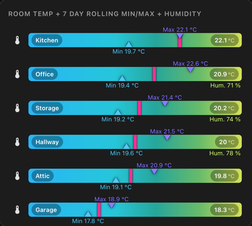

```yaml
type: custom:sensor-bar-card-plus
title: Room Temp + 7 Day Rolling Min/Max + Humidity
entities:
  - entity: sensor.keuken_temperature
    name: Kitchen
  - entity: sensor.bureau_temperature
    name: Office
    markers:
      - at: 100%
        label:
          entity: sensor.bureau_humidity
          show: true
          text: Hum.
        show_marker: false
        color: '#d4fb79'
  - entity: sensor.berging_temperature
    name: Storage
    markers:
      - at: 100%
        label:
          entity: sensor.berging_humidity
          show: true
          text: Hum.
        show_marker: false
        color: '#d4fb79'
  - entity: sensor.nachthal_boven_temperature
    name: Hallway
    markers:
      - at: 100%
        label:
          entity: sensor.nachthal_boven_humidity
          show: true
          text: Hum.
        show_marker: false
        color: '#d4fb79'
  - entity: sensor.zolder_onder_cv_temperature
    name: Attic
  - entity: sensor.garage_onder_pomp_temperature
    name: Garage

scale:
  min: { fixed: 15 }
  max: { fixed: 25 }

layout:
  height: 28
  label:
    position: inside

peak:
  enabled: true
  window: 7d
  label: { show: true, text: Max }
  color: '#8b7cff'

floor:
  enabled: true
  window: 7d
  label: { show: true, text: Min }
  color: '#55c7f3'

bar:
  fill_style: band_gradient
  needle:
    show: true
    color: '#ff2f92'
  segments:
    - { from: 5, to: 10, color: '#3949AB' }
    - { from: 10, to: 15, color: '#1E88E5' }
    - { from: 15, to: 18, color: '#29B6F6' }
    - { from: 18, to: 20, color: '#26C6DA' }
    - { from: 20, to: 22, color: '#26A69A' }
    - { from: 22, to: 24, color: '#66BB6A' }
    - { from: 24, to: 26, color: '#D4E157' }
    - { from: 26, to: 28, color: '#FFCA28' }
    - { from: 28, to: 30, color: '#FFA726' }
    - { from: 30, to: 33, color: '#FB8C00' }
    - { from: 33, to: 36, color: '#E53935' }
    - { from: 36, to: 40, color: '#8E24AA' }
```

The historical extrema come directly from Home Assistant Recorder; no helper package is required. Recorder retention and compatible statistics must cover the requested window. See [Recorder, statistics, and coverage](configuration.md#recorder-statistics-and-coverage) for requirements and limitations. The fixed Scale keeps all six rooms comparable; optional dynamic minimum or maximum sources can be configured separately if the desired range varies.

The example uses `at: 100%` for label-only humidity markers: the label reads the humidity entity, while the marker glyph is hidden. For reusable Home Assistant extrema entities, automation inputs, or a historical max-minus-min delta, see the [optional advanced helper-sensor guide](../examples/sbcp_historical_extrema_HOWTO.md).

**Temperature color scale**

The `band_gradient` uses a temperature palette inspired by weather-map colors, progressing from cool blues through greens and yellows to warm oranges, reds and purples. It is not an exact reproduction of an official Met Office palette.

The temperature segments deliberately cover a wider range (5–40 °C) than the visible scale (15–25 °C). They extend beyond the visible scale intentionally, so the same colors support dynamic scale bounds without redefining the temperature bands. Each temperature retains its corresponding color as the displayed minimum and maximum change.

### Daikin: One Entity, Seven Values

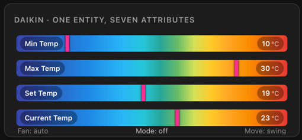

Four rows read the attributes `min_temp`, `max_temp`, `temperature`, and `current_temperature` from the same `climate.daikin_living_room_temperature` entity. The final row adds three independent label-only Reference Markers: the entity state (operating mode) at 50%, `fan_mode` at 0%, and `swing_horizontal_mode` at 100%. Each uses `show_marker: false`, which hides the shape while leaving its label visible.

The Scale is fixed at 4–36 °C. The temperature-based `band_gradient` segments cover 5–40 °C and keep their temperature colors if the Scale bounds later become dynamic. This example needs only the climate entity and its supported attributes; it does not require template sensors or additional helper entities.

```yaml
type: custom:sensor-bar-card-plus
title: DAIKIN · ONE ENTITY, SEVEN ATTRIBUTES
entities:
  - entity: climate.daikin_living_room_temperature
    name: Min Temp
    icon: false
    markers: []
    attribute: min_temp
  - entity: climate.daikin_living_room_temperature
    name: Max Temp
    icon: false
    markers: []
    attribute: max_temp
  - entity: climate.daikin_living_room_temperature
    name: Set Temp
    icon: false
    markers: []
    attribute: temperature
  - entity: climate.daikin_living_room_temperature
    name: Current Temp
    icon: false
    markers:
      - at: 50%
        label:
          show: true
          entity: climate.daikin_living_room_temperature
          text: 'Mode:'
        show_marker: false
        color: '#c2c2c2'
      - at: 0%
        show_marker: false
        label:
          show: true
          entity:
            id: climate.daikin_living_room_temperature
            attribute: fan_mode
          text: 'Fan:'
      - at: 100%
        label:
          show: true
          entity:
            id: climate.daikin_living_room_temperature
            attribute: swing_horizontal_mode
          text: 'Move:'
        show_marker: false
    attribute: current_temperature
scale:
  min:
    fixed: 4
  max:
    fixed: 36
layout:
  height: 28
  label:
    position: inside
formatting:
  unit: °C
bar:
  fill_style: band_gradient
  needle:
    show: true
    color: '#ff2f92'
  segments:
    - from: 5
      to: 10
      color: '#3949AB'
    - from: 10
      to: 15
      color: '#1E88E5'
    - from: 15
      to: 18
      color: '#29B6F6'
    - from: 18
      to: 20
      color: '#26C6DA'
    - from: 20
      to: 22
      color: '#26A69A'
    - from: 22
      to: 24
      color: '#66BB6A'
    - from: 24
      to: 26
      color: '#D4E157'
    - from: 26
      to: 28
      color: '#FFCA28'
    - from: 28
      to: 30
      color: '#FFA726'
    - from: 30
      to: 33
      color: '#FB8C00'
    - from: 33
      to: 36
      color: '#E53935'
    - from: 36
      to: 40
      color: '#8E24AA'
```

### Battery percentage at a glance

Use Hero for a prominent battery reading, with a simple cyan reveal fill. Choose a sensor already reporting a percentage.

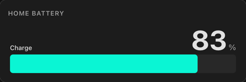

```yaml
type: custom:sensor-bar-card-plus
title: Home Battery
layout:
  label: { position: hero }
  hero: { size: small }
scale:
  min: { fixed: 0 }
  max: { fixed: 100 }
formatting: { decimal: 0 }
bar: { fill_style: solid, color: "#00F5D4" }
entities:
  - entity: sensor.battery_percent
    name: Charge
```

### House power with a limit

This uses the same Gradient palette and blue exceeded paint as the comparisons. The fixed Target highlights only the revealed part above 6500 W; it does not recolor the whole bar.

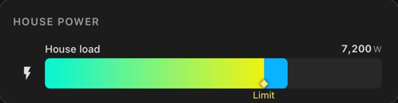

```yaml
type: custom:sensor-bar-card-plus
title: House Power
layout: { label: { position: above } }
scale:
  min: { fixed: 0 }
  max: { fixed: 10000 }
formatting: { decimal: 0 }
bar:
  fill_style: gradient
  gradient_stops:
    - { pos: 0, color: "#00F5D4" }
    - { pos: 70, color: "#FFF200" }
    - { pos: 100, color: "#FF007F" }
target:
  at: { fixed: 6500 }
  color: "#FDE68A"
  label: { show: true, text: Limit, show_value: false, show_unit: false }
  when_exceeded: { fill_color: "#00B2FF" }
entities:
  - entity: sensor.house_power
    name: House load
```

### Power relative to a live reference

Baseline shows how far the reading lies above or below a live reference, with the same blue/green side colors as the comparison. A Pin labels that origin; an independent **Now** label shows the reading at the rail endpoint. Use a reference source in the same unit as the power sensor.

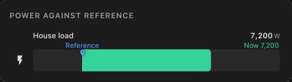

```yaml
type: custom:sensor-bar-card-plus
title: Power Against Reference
layout: { label: { position: above } }
scale:
  min: { fixed: 0 }
  max: { fixed: 10000 }
formatting: { decimal: 0 }
bar: { fill_style: solid, color: "#00F5D4" }
baseline:
  at: { entity: input_number.power_reference, fixed: 2000 }
  below: { color: "#60A5FA" }
  above: { color: "#34D399" }
markers:
  - at: { entity: input_number.power_reference, fixed: 2000 }
    lane: above
    shape: pin
    direction: inward
    color: "#60A5FA"
    label: { show: true, text: Reference, show_value: false, show_unit: false }
  - at: 100%
    lane: above
    show_marker: false
    color: "#34D399"
    label: { show: true, text: Now, entity: sensor.house_power, show_unit: false, precision: 0 }
entities:
  - entity: sensor.house_power
    name: House load
```

For more combinations, continue with the [Configuration Reference](configuration.md) or the [recipe catalogue](../examples/recipes/README.md).
